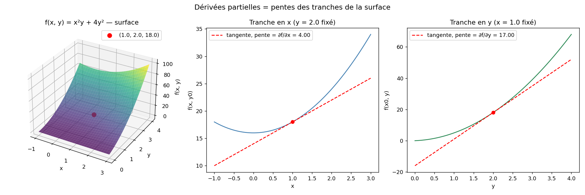

# Partial Derivatives 🔍

When a function depends on several variables — for example $f(x, y)$ — the **partial derivative** measures how the function changes when I vary **a single variable**, keeping all others constant.

## Notation

I denote the partial derivative with respect to $x$ as:

$$\frac{\partial f}{\partial x} \quad \text{or} \quad f'_x$$

And with respect to $y$:

$$\frac{\partial f}{\partial y} \quad \text{or} \quad f'_y$$

## Worked example

I take the following simplified cost function:

$$f(x, y) = 3x^2 + 2xy + y^3$$

To compute $\dfrac{\partial f}{\partial x}$, I treat $y$ as a plain constant (like any fixed number: 2, 5, etc.):

$$\frac{\partial f}{\partial x} = 6x + 2y$$

To compute $\dfrac{\partial f}{\partial y}$, I treat $x$ as a constant:

$$\frac{\partial f}{\partial y} = 2x + 3y^2$$

## My turn! ✏️

Before jumping to Python, I made myself apply the theory to a small practical case.

Given:

$$f(x, y) = x^2 y + 4y^2$$

- What is $\dfrac{\partial f}{\partial x}$?
- What is $\dfrac{\partial f}{\partial y}$?

## Computing it numerically: the intuition 💡

- **The small variation $h$**: I take a very small step (e.g. $10^{-5}$) to zoom in on the curve around the point $(x, y)$. See [the note on step size](../README.md#a-note-on-the-step-size-h) in the sub-section index for why $10^{-5}$ specifically.
- **Isolating the variable**:
  - To get $\dfrac{\partial f}{\partial x}$, I evaluate the function slightly to the right $f(x+h, y)$ and slightly to the left $f(x-h, y)$. I don't touch $y$!
  - To get $\dfrac{\partial f}{\partial y}$, it's the opposite: $x$ stays fixed, and I vary $y$.
- **Computing the slope**: the difference $(f_{plus} - f_{minus})$ divided by the total distance $2h$ gives me the exact slope of the tangent (the partial derivative).

## Two ways I can compute this in software

| Type of computation | What the program does | Example input | Example output | Main Python tool |
|---|---|---|---|---|
| **Numerical** | Computes exact or approximated values at a specific point $(x, y)$. | $x=1, y=2$ | The number $17.0$ | NumPy |
| **Symbolic** | Manipulates variables like on paper to find the mathematical expression of the derivative. | $f(x, y) = x^2 y + 4y^2$ | The expression $x^2 + 8y$ | SymPy |

### Comparing the methods

| Method | How it works | Advantage | Drawback | Used where? |
|---|---|---|---|---|
| **Symbolic** (SymPy) | Manipulates algebraic expressions to produce a formal formula. | Gives the exact equation $2xy$. | Very slow, requires a substitution step to evaluate at a point. | Theoretical math, formal computation, proof verification. |
| **Numerical** (NumPy) | Uses $\dfrac{f(x+h) - f(x-h)}{2h}$. | Very simple to implement. | Approximation (round-off errors), requires evaluating $f$ multiple times per parameter. | Gradient validation tests ("Gradient Checking"). |
| **Delegated / Automatic** (PyTorch / Autograd) | Computes the exact gradient value at a given point by building a computation graph. | Ultra-fast, exact up to machine precision, ideal for millions of parameters. | Requires a dedicated autodiff framework. | All of modern Deep Learning (Backpropagation). |

## Visualization 📊

I plotted the surface of $f(x, y) = x^2y + 4y^2$ and sliced it along $x$ and along $y$ at the evaluation point $(1, 2)$: the slope of each slice's tangent line is exactly the partial derivative in that direction.



*Generated by [`plot_partial_derivatives.py`](plot_partial_derivatives.py).*

## Scripts in this folder

- [`partial_derivatives.py`](partial_derivatives.py) — my "from scratch" implementation: `partial_derivative_x`/`partial_derivative_y` via centered finite differences, checked against the hand-computed exact values.
- [`interactive_partial_derivatives.py`](interactive_partial_derivatives.py) — comparison with a standard library: SymPy computes the symbolic derivative for display, NumPy computes the numeric one via finite differences.
- [`plot_partial_derivatives.py`](plot_partial_derivatives.py) — the visualization above.

## Pseudo-code: Partial Derivative (Central Difference)

```text
ALGORITHM: Calculate Partial Derivative

INPUT:
    - f: scalar function f(x, y)
    - point: vector containing [x, y]
    - var_index: index of the variable to differentiate (0 for x, 1 for y)
    - h: step size (default = 1e-5)

OUTPUT:
    - df_dvar: partial derivative value at the given point

BEGIN
    1. Create a copy of 'point' named 'point_plus'
    2. Create a copy of 'point' named 'point_minus'

    3. Add 'h' to 'point_plus' at position 'var_index'      // (e.g., [x + h, y] if var_index == 0)
    4. Subtract 'h' from 'point_minus' at position 'var_index' // (e.g., [x - h, y] if var_index == 0)

    5. Evaluate f_plus = f(point_plus)
    6. Evaluate f_minus = f(point_minus)

    7. Compute df_dvar = (f_plus - f_minus) / (2 * h)

    RETURN df_dvar
END
```

## Pseudo-code: Interactive Partial Derivatives & Gradient Calculator

```text
ALGORITHM: Interactive Partial Derivatives & Gradient Calculator

INPUT:
    - expr_str: mathematical expression entered by user as text (e.g., "x**2 * y + 4*y**2")
    - x_val: numeric float value for x
    - y_val: numeric float value for y
    - h: step size for numerical derivative (default = 1e-5)

OUTPUT:
    - Symbolic partial derivatives (text formulas via SymPy)
    - Numeric values of partial derivatives evaluated at (x_val, y_val) via NumPy
    - Gradient Vector: ∇f(x, y) = [df/dx, df/dy]

BEGIN
    1. Define symbolic variables 'x' and 'y' using SymPy
    2. Parse 'expr_str' into a symbolic expression f_expr

    3. Compute SYMBOLIC partial derivatives (for display purpose):
          df_dx_expr = diff(f_expr, x)
          df_dy_expr = diff(f_expr, y)

    4. Convert symbolic expression f_expr into a fast NumPy-compatible function:
          f_num = lambdify((x, y), f_expr, 'numpy')

    5. Compute NUMERICAL partial derivatives at point (x_val, y_val) using central differences with NumPy:
          df_dx_num = (f_num(x_val + h, y_val) - f_num(x_val - h, y_val)) / (2 * h)
          df_dy_num = (f_num(x_val, y_val + h) - f_num(x_val, y_val - h)) / (2 * h)

    6. Construct the Gradient Vector with NumPy:
          gradient_vector = array([df_dx_num, df_dy_num])

    7. Display symbolic formulas (SymPy), numerical evaluations (NumPy), and the Gradient Vector
END
```

⬅️ Back to [Multivariable Calculus overview](../README.md) · Next: [Gradient Vector](../02-gradient-vector/README.md)
