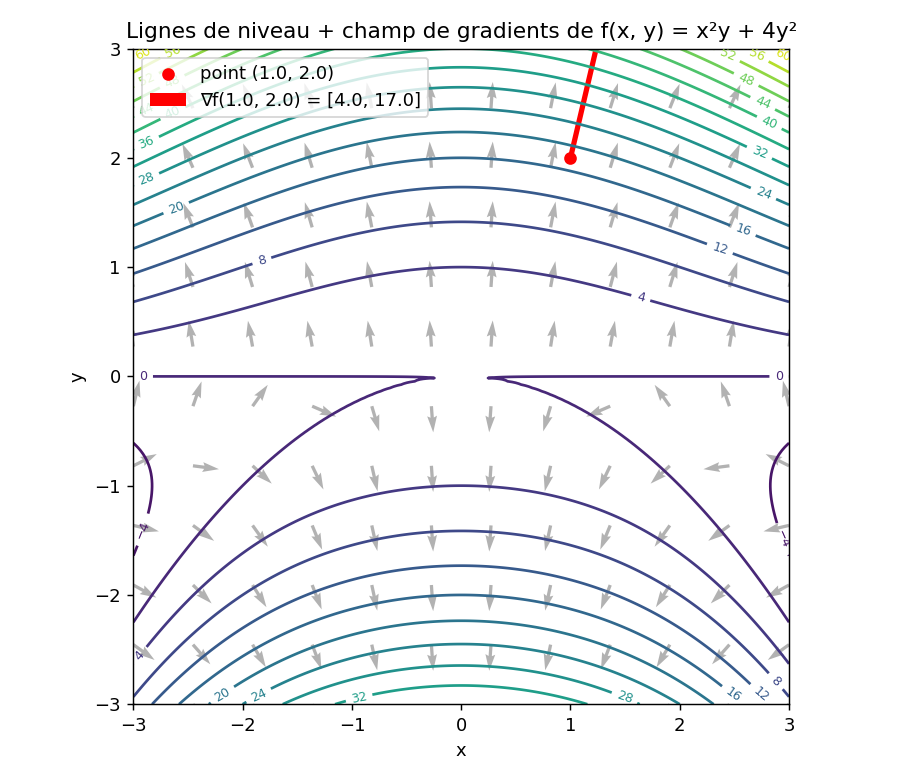

# The Gradient Vector 🧭

The **gradient** gathers all the partial derivatives of a function into a single vector. I covered [Partial Derivatives](../01-partial-derivatives/README.md) first - worth reading before this one.

## Definition

For a function $f(x, y)$, I write the gradient vector (denoted $\nabla f$, read "nabla f") as:

$$\nabla f(x, y) = \begin{pmatrix} \dfrac{\partial f}{\partial x} \\[6pt] \dfrac{\partial f}{\partial y} \end{pmatrix}$$

## Key geometric property

The gradient vector has two characteristics that are crucial for Machine Learning:

- **Direction**: it always points toward the direction where the function increases the fastest.
- **Norm (magnitude)**: its size tells me how steep the slope is.

> 💡 **The link to optimization (Gradient Descent):**
> To reduce an error (minimize a cost function), I move in the direction **opposite** to the gradient: $-\nabla f$.

## Script structure

To keep some software-engineering rigor (doctests, typing, docstrings), I compute the gradient two ways and cross-check them:

1. **Analytical (exact) approach**: a Python function that computes the exact gradient vector at point $(x, y)$.
2. **Numerical approach (finite differences)**: a generic function that computes the gradient of any function using the centered finite-difference approximation:

$$\frac{\partial f}{\partial x} \approx \frac{f(x + h, y) - f(x - h, y)}{2h}$$

3. **Validation**: comparing the exact (analytical) value against the numerical approximation to make sure my implementation is correct.

## Visualization 📊

I plotted the level curves of $f(x, y) = x^2y + 4y^2$ together with its gradient field: every gray arrow points toward steepest ascent, and the red arrow at $(1, 2)$ is $\nabla f(1, 2)$ - perpendicular to the level curve through that point, exactly as the theory predicts.



*Generated by [`plot_gradient_vector.py`](plot_gradient_vector.py).*

## Scripts in this folder

- [`gradient_vector.py`](gradient_vector.py) - `analytical_gradient` (exact formula) vs. `numerical_gradient` (centered finite differences), with a validation check (`np.allclose`) between the two.
- [`plot_gradient_vector.py`](plot_gradient_vector.py) - the visualization above.

## Pseudo-code: Gradient Vector

```text
ALGORITHM: Calculate Gradient Vector

INPUT:
    - f: scalar function
    - point: vector [x1, x2, ..., xn]
    - h: step size

OUTPUT:
    - grad: vector containing all partial derivatives [df/dx1, df/dx2, ..., df/dxn]

BEGIN
    1. Initialize 'grad' array of the same size as 'point' with zeros
    2. FOR each index 'i' from 0 to length(point) - 1 DO:
           grad[i] = Calculate Partial Derivative(f, point, var_index=i, h)
       END FOR

    RETURN grad
END
```

⬅️ Back to [Multivariable Calculus overview](../README.md) · Previous: [Partial Derivatives](../01-partial-derivatives/README.md) · Next: [Jacobian Matrix](../03-jacobian-matrix/README.md)
