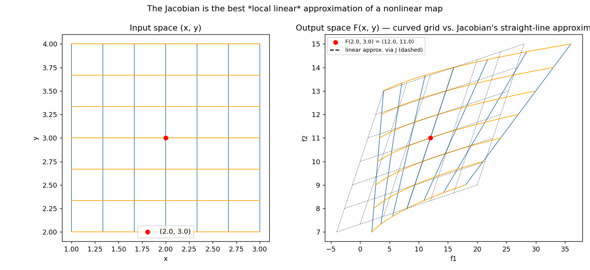

# The Jacobian Matrix 🧮

## From gradient to Jacobian

So far, I've worked with functions that take several inputs $(x, y)$ but produce a single scalar output: $f(x, y) \in \mathbb{R}$ - see [Partial Derivatives](../01-partial-derivatives/README.md) and [the Gradient Vector](../02-gradient-vector/README.md). The gradient gathers all the partial derivatives into a single vector.

The **Jacobian matrix** is simply the generalization of the gradient for functions with several inputs **and** several outputs:

$$\mathbf{F}(x, y) = \begin{pmatrix} f_1(x, y) \\ f_2(x, y) \end{pmatrix}$$

Each **row** of the Jacobian matrix is the gradient of one of the output functions:

$$\mathbf{J} = \begin{pmatrix} \dfrac{\partial f_1}{\partial x} & \dfrac{\partial f_1}{\partial y} \\[6pt] \dfrac{\partial f_2}{\partial x} & \dfrac{\partial f_2}{\partial y} \end{pmatrix}$$

## Worked example

I take a function $\mathbf{F}$ that takes a 2D point $(x, y)$ as input and returns a 2D vector as output:

$$\mathbf{F}(x, y) = \begin{pmatrix} f_1(x, y) \\ f_2(x, y) \end{pmatrix} = \begin{pmatrix} x^2 y \\ x + 3y \end{pmatrix}$$

**Symbolic partial derivatives**, computed one at a time:

- $\dfrac{\partial f_1}{\partial x} = 2xy$
- $\dfrac{\partial f_1}{\partial y} = x^2$
- $\dfrac{\partial f_2}{\partial x} = 1$
- $\dfrac{\partial f_2}{\partial y} = 3$

Which gives me the symbolic Jacobian matrix:

$$J(x, y) = \begin{pmatrix} 2xy & x^2 \\ 1 & 3 \end{pmatrix}$$

**Evaluating at a specific point** $(x = 2, y = 3)$:

- $2xy = 2 \cdot 2 \cdot 3 = 12$
- $x^2 = 2^2 = 4$

$$J(2, 3) = \begin{pmatrix} 12 & 4 \\ 1 & 3 \end{pmatrix}$$

> 💡 **Reading the matrix**: row 1 corresponds to output $f_1$, column 1 corresponds to input $x$. The entry $J_{11} = 12$ is the partial derivative $\dfrac{\partial f_1}{\partial x}$ - it tells me $f_1$'s *sensitivity* to $x$. If I nudge $x$ by $+0.01$ (keeping $y = 3$ fixed), $f_1$ increases by roughly $12 \times 0.01 = +0.12$: each entry of the Jacobian is a local rate of change, exactly like a single partial derivative.

## General shape rule

For a function $\mathbf{F}: \mathbb{R}^n \to \mathbb{R}^m$ (with $n$ inputs and $m$ outputs), the Jacobian matrix has shape $m \times n$: **one row per output, one column per input**.

For example, with 3 input variables and 2 output functions:

$$J = \begin{pmatrix} \dfrac{\partial f_1}{\partial x_1} & \dfrac{\partial f_1}{\partial x_2} & \dfrac{\partial f_1}{\partial x_3} \\[6pt] \dfrac{\partial f_2}{\partial x_1} & \dfrac{\partial f_2}{\partial x_2} & \dfrac{\partial f_2}{\partial x_3} \end{pmatrix} \quad (2 \times 3 \text{ matrix})$$

## Two ways to read the Jacobian

The same object is used very differently depending on the field:

- **Geometry / analysis** 📐: the Jacobian measures how a transformation deforms space (change of variables, volume computation via the Jacobian determinant, surface deformation). More formally, it's the linear map that gives the best local approximation of a differentiable function between two vector spaces.
- **Machine Learning** 🤖: the Jacobian measures how sensitive each output of a model is to each input. If a neural network layer takes a 3D input vector $X$ and produces a 2D output vector $Y$, the Jacobian matrix contains every rate of change needed to propagate the error backward (**backpropagation**).

## The Jacobian inside a neural network layer

I take a dense (fully-connected) layer with 3 inputs ($x_1, x_2, x_3$) and 2 output neurons ($z_1, z_2$), each computed as a weighted sum plus a bias:

$$z_1 = w_{11}x_1 + w_{12}x_2 + w_{13}x_3 + b_1$$
$$z_2 = w_{21}x_1 + w_{22}x_2 + w_{23}x_3 + b_2$$

During training, backpropagation needs to answer: *"If I slightly change input $x_1$, how does it affect $z_1$ **and** $z_2$?"* That information is exactly the Jacobian of the layer, $\mathbf{J} = \dfrac{\partial \mathbf{z}}{\partial \mathbf{x}}$:

$$J = \begin{pmatrix} \dfrac{\partial z_1}{\partial x_1} & \dfrac{\partial z_1}{\partial x_2} & \dfrac{\partial z_1}{\partial x_3} \\[6pt] \dfrac{\partial z_2}{\partial x_1} & \dfrac{\partial z_2}{\partial x_2} & \dfrac{\partial z_2}{\partial x_3} \end{pmatrix} = \begin{pmatrix} w_{11} & w_{12} & w_{13} \\ w_{21} & w_{22} & w_{23} \end{pmatrix}$$

**Key takeaway**: for a linear layer $Z = WX + B$, the Jacobian with respect to the input $X$ is nothing but the weight matrix $W$ itself. This is why libraries like PyTorch and TensorFlow are, under the hood, continuously multiplying Jacobian matrices together (via the chain rule) to propagate the error from layer to layer.

## Backpropagation & Gradient Descent - putting it all together 🔄

### The learning cycle

Training a neural network loops through three phases:

1. **Forward pass** ➡️: input data flows through the network, layer by layer, to produce a prediction.
2. **Loss calculation** 🎯: a cost function (e.g. squared error) compares the prediction to the true target to measure the overall error $\mathcal{L}$.
3. **Backpropagation** ⬅️: the error computed at the output is propagated backward through the network.

### The chain rule and the Jacobian

During backpropagation, the gradient of the loss $\mathcal{L}$ is needed with respect to every weight $w$ and bias $b$. For a simple chain $x \to (\text{neuron}, w) \to \hat{y} \to \mathcal{L}$, the chain rule multiplies local sensitivities:

$$\frac{\partial \mathcal{L}}{\partial w} = \frac{\partial \mathcal{L}}{\partial \hat{y}} \times \frac{\partial \hat{y}}{\partial w}$$

In a deep network with several layers and neurons, these local-sensitivity computations become **Jacobian matrix multiplications**. Concretely, for a layer with 3 inputs and 2 outputs, the layer's Jacobian $\dfrac{\partial Z}{\partial X}$ has shape $2 \times 3$, and the incoming error vector from the layer above, $\dfrac{\partial \mathcal{L}}{\partial Z}$, has shape $1 \times 2$ (one value per output). Multiplying them:

$$\underbrace{\frac{\partial \mathcal{L}}{\partial X}}_{1 \times 3} = \underbrace{\frac{\partial \mathcal{L}}{\partial Z}}_{1 \times 2} \times \underbrace{\frac{\partial Z}{\partial X}}_{2 \times 3}$$

redistributes the output error back onto each of the 3 inputs - this is exactly how the error "climbs back" through every layer of the network.

### Gradient Descent recap

**Gradient Descent** is the optimization algorithm that uses these gradients to actually minimize the loss - like descending a mountain in the fog 🌫️: at each step, I look at the slope under my feet and step in the steepest downward direction.

| Component | Role |
|---|---|
| Cost function $\mathcal{L}$ | Measures the model's overall error; the quantity I want to minimize. |
| Gradient $\nabla \mathcal{L}$ | Vector of all partial derivatives of the loss; always points toward the steepest **increase**. |
| Learning rate $\eta$ | Small positive number (e.g. $0.01$) controlling the step size at each iteration. |

Update rule for a weight $w$:

$$w_{\text{new}} = w_{\text{current}} - \eta \cdot \frac{\partial \mathcal{L}}{\partial w}$$

The **minus sign** is crucial: since the gradient points where the function increases, I step in the opposite direction to decrease it. For example, if $\dfrac{\partial \mathcal{L}}{\partial w} = +5$ (increasing $w$ increases the error), the update rule *decreases* $w$ - exactly what I want.

**Algorithm outline:**

1. Initialize weights (often randomly).
2. Compute the prediction and current error (forward pass).
3. Compute the gradient of the error with respect to every weight (backpropagation).
4. Update every weight using the rule above.
5. Repeat steps 2–4 until the error stops decreasing (convergence).

## Visualization 📊

Since $\mathbf{F}: \mathbb{R}^2 \to \mathbb{R}^2$ isn't a single surface I can plot, I visualized what the Jacobian actually *means*: how $F$ deforms space. I mapped a small grid around $(2, 3)$ through $F$ - the grid comes out curved (F is nonlinear) - and overlaid the straight-line approximation predicted by the Jacobian. They match closely right at the evaluation point, then drift apart: that's the "local" in "local linear approximation".



*Generated by [`plot_jacobian_matrix.py`](plot_jacobian_matrix.py).*

## Scripts in this folder

- [`jacobian_matrix.py`](jacobian_matrix.py) - `compute_jacobian` via centered finite differences, demonstrated on the worked example above ($\mathbb{R}^2 \to \mathbb{R}^2$) and on a dense neural network layer ($\mathbb{R}^3 \to \mathbb{R}^2$), confirming that the Jacobian of a linear layer equals its weight matrix $W$.
- [`plot_jacobian_matrix.py`](plot_jacobian_matrix.py) - the visualization above.

## Pseudo-code: Jacobian Matrix (Central Difference)

```text
ALGORITHM: Calculate Jacobian Matrix

INPUT:
    - F: vector-valued function returning an array of size m
    - point: vector [x1, x2, ..., xn] of size n
    - h: step size (default = 1e-5)

OUTPUT:
    - J: Jacobian matrix of size (m x n)

BEGIN
    1. Evaluate F_ref = F(point)
    2. Set m = length(F_ref)
    3. Set n = length(point)

    4. Initialize J as a zero matrix of shape (m, n)

    5. FOR each column index 'j' from 0 to n - 1 DO:
           Create copy 'point_plus' = point
           Create copy 'point_minus' = point

           point_plus[j] = point_plus[j] + h
           point_minus[j] = point_minus[j] - h

           F_plus = F(point_plus)
           F_minus = F(point_minus)

           // Compute numerical partial derivative for all outputs with respect to variable j
           J[:, j] = (F_plus - F_minus) / (2 * h)
       END FOR

    RETURN J
END
```

⬅️ Back to [Multivariable Calculus overview](../README.md) · Previous: [Gradient Vector](../02-gradient-vector/README.md) · Next: [Hessian Matrix](../04-hessian-matrix/README.md)
