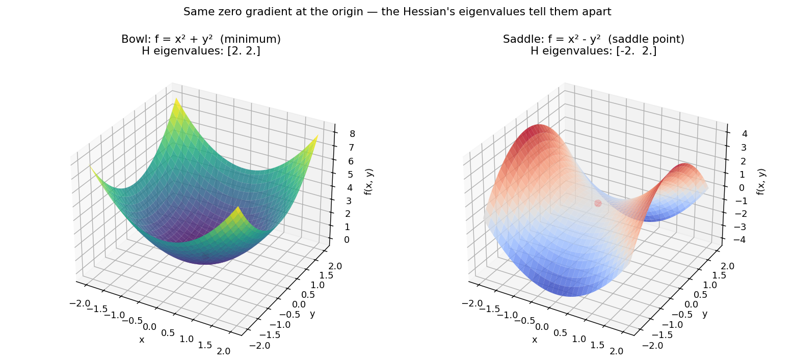

# The Hessian Matrix 🧠

If the [Jacobian matrix](../03-jacobian-matrix/README.md) gathers all the **first** derivatives of a function (its rate of change, its slope), the **Hessian matrix** gathers all its **second** derivatives - the *curvature* of the function.

## What kind of function is this for?

The Hessian applies to functions with several inputs $(x_1, x_2, \dots, x_n)$ that produce a single scalar output $f(\mathbf{x}) \in \mathbb{R}$ - exactly the shape of the loss functions I use in Machine Learning.

## Definition and structure

For a function $f(x, y)$, the Hessian matrix $H$ is:

$$H = \begin{pmatrix} \dfrac{\partial^2 f}{\partial x^2} & \dfrac{\partial^2 f}{\partial x \partial y} \\[6pt] \dfrac{\partial^2 f}{\partial y \partial x} & \dfrac{\partial^2 f}{\partial y^2} \end{pmatrix}$$

- **Rows & columns**: for a function of $n$ input variables, the Hessian is a **square** $n \times n$ matrix.
- **Schwarz's theorem (the symmetry of it all)**: if the second derivatives are continuous, the mixed (cross) derivatives are equal: $\dfrac{\partial^2 f}{\partial x \partial y} = \dfrac{\partial^2 f}{\partial y \partial x}$. So the Hessian matrix is always **symmetric** ($H = H^T$).

## Worked example

I take the following function of 2 variables:

$$f(x, y) = 3x^2y + 2y^3 - 5x$$

**First derivatives (gradient):**

- $\dfrac{\partial f}{\partial x} = 6xy - 5$
- $\dfrac{\partial f}{\partial y} = 3x^2 + 6y^2$

**Second derivatives (Hessian)**, computed one at a time:

- $\dfrac{\partial^2 f}{\partial x^2} = \dfrac{\partial}{\partial x}(6xy - 5) = 6y$
- $\dfrac{\partial^2 f}{\partial x \partial y} = \dfrac{\partial}{\partial y}(6xy - 5) = 6x$
- $\dfrac{\partial^2 f}{\partial y \partial x} = \dfrac{\partial}{\partial x}(3x^2 + 6y^2) = 6x$
- $\dfrac{\partial^2 f}{\partial y^2} = \dfrac{\partial}{\partial y}(3x^2 + 6y^2) = 12y$

Which gives the symbolic Hessian matrix:

$$H(x, y) = \begin{pmatrix} 6y & 6x \\ 6x & 12y \end{pmatrix}$$

**Evaluating at the point** $(x = 1, y = 2)$:

$$H(1, 2) = \begin{pmatrix} 12 & 6 \\ 6 & 24 \end{pmatrix}$$

> 💡 **Quick check I gave myself**: for a Machine Learning cost function taking 5 input variables (weights), what shape would its Hessian matrix have? - $5 \times 5$, one row/column per weight, since the Hessian of an $n$-variable function is always $n \times n$.

## Reading curvature: bowl vs. mountain pass

The easiest way I found to picture the Hessian is a geographical metaphor: the relief of a landscape 🏔️. Imagine measuring an altitude (my loss function $\mathcal{L}$) as a function of my position $(x, y)$ on a terrain (my parameters/weights):

- **At the bottom of a bowl-shaped valley 🥣 (a minimum)**: the slope is zero ($\nabla \mathcal{L} = \mathbf{0}$), and no matter which direction I step in, the terrain goes back up. The curvature is positive in every direction - the Hessian tells me I'm on a local minimum.
- **On a mountain pass 🐴 (a saddle point)**: the slope is also zero! The gradient alone can't tell the difference from a minimum. But looking at the curvature via the Hessian: walking along the ridge (x-axis), the terrain goes down (negative curvature); walking across the pass (y-axis), it goes up (positive curvature). The Hessian warns me: *"careful, this is a saddle point, not a real minimum!"*

I checked this visually below - see [Visualization](#visualization).

## Why the Hessian matters in Machine Learning

Plain Gradient Descent walks blindly with a fixed step size ($\eta$). If the slope is very steep in one direction and very flat in another (a narrow valley), gradient descent oscillates from one wall to the other instead of making progress toward the bottom.

This is where **second-order optimization** (like Newton's Method) comes in:

$$\Delta \mathbf{x} = - H^{-1} \nabla \mathcal{L}$$

- The Hessian ($H$) measures the curvature in every direction.
- By taking its inverse ($H^{-1}$), the algorithm automatically adapts the step size:
  - 📈 **Steep curvature**: it takes small steps to avoid overshooting the bottom of the valley.
  - 📉 **Flat curvature**: it takes large steps to cross flat regions quickly.

The algorithm then heads straight for the minimum in very few steps!

### Reading the sign of the diagonal

Here's the logic I walked through to convince myself of the signs on the diagonal:

- The first derivative ($\partial f / \partial x$) gives the slope.
- The second derivative ($\partial^2 f / \partial x^2$) measures how that slope changes as I move left to right.
- Walking through the bottom of a bowl 🥣 left to right ($x$ increasing): the slope goes from negative (going down) → zero (the bottom) → positive (going up). **The slope increases** - so the second derivative is **positive**.
- Walking over the top of a dome ⛰️ (a maximum): the slope goes from positive → zero → negative. **The slope decreases** - so the second derivative is **negative**.

| Shape of the terrain | Slope trend | Sign of the second derivative (diagonal) |
|---|---|---|
| 🥣 Bowl / valley (minimum) | increases (negative → positive) | **POSITIVE** (+) 📈 |
| ⛰️ Dome / peak (maximum) | decreases (positive → negative) | **NEGATIVE** (−) 📉 |

So for a loss function $\mathcal{L}$: a minimum (bowl) means a positive second derivative; a maximum (dome) means a negative one - and a saddle point means the diagonal terms disagree in sign.

## Visualization 📊

I plotted a bowl ($f = x^2 + y^2$) next to a saddle ($f = x^2 - y^2$) - both have a zero gradient at the origin, but their Hessian eigenvalues tell them apart (both positive for the bowl, mixed signs for the saddle):



*Generated by [`plot_hessian_matrix.py`](plot_hessian_matrix.py).*

## Scripts in this folder

- [`hessian_matrix.py`](hessian_matrix.py) - `compute_hessian` via centered finite differences (pure second derivatives on the diagonal, 4-point mixed derivatives off it), validated against the hand-computed matrix and checked for symmetry.
- [`plot_hessian_matrix.py`](plot_hessian_matrix.py) - 3D surfaces of a bowl and a saddle, annotated with their Hessian eigenvalues.

## Pseudo-code: Hessian Matrix (Central Difference)

```
ALGORITHM: Calculate Hessian Matrix

INPUT:
    - f: scalar function taking a vector of size n and returning a real number
    - point: vector [x1, x2, ..., xn] of size n
    - h: step size (default = 1e-4)

OUTPUT:
    - H: square Hessian matrix of size (n x n)

BEGIN
    1. Let n = length(point)
    2. Initialize H as an n x n matrix filled with zeros

    3. FOR each row 'i' from 0 to n - 1 DO:
           FOR each column 'j' from 0 to n - 1 DO:

               IF i == j THEN (pure second derivative)
                   // Centered difference formula for f''(x):
                   // (f(x+h) - 2*f(x) + f(x-h)) / (h^2)

               ELSE (mixed second derivative)
                   // Centered difference formula for d^2f / (dxi dxj):
                   // (f(x+hi+hj) - f(x+hi-hj) - f(x-hi+hj) + f(x-hi-hj)) / (4*h^2)

           END FOR
       END FOR

    RETURN H
END
```

⬅️ Back to [Multivariable Calculus overview](../README.md) · Previous: [Jacobian Matrix](../03-jacobian-matrix/README.md)
