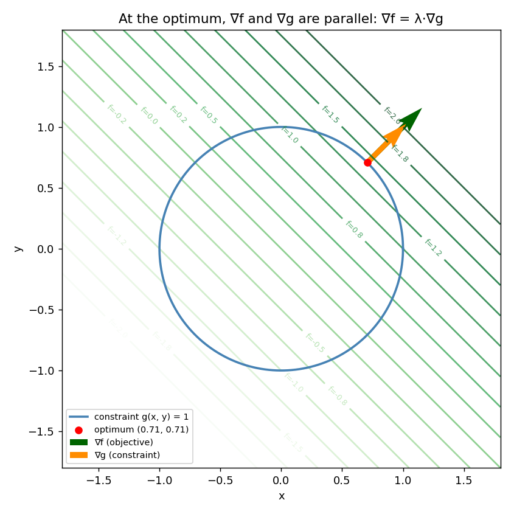

# Lagrangian Multipliers ⚖️

**Lagrangian multipliers** are a powerful tool for **constrained optimization**. I explored this method step by step.

## The problem: optimizing under a constraint

In plain optimization (like gradient descent), I look for the minimum or maximum of a function $f(x, y)$ with no restriction at all.

But in Machine Learning and physics, I often run into constraints:

- 💰 Maximize a profit $f(x, y)$ without exceeding a budget $g(x, y) = c$.
- 🛡️ Minimize a model's error under a regularization constraint (e.g. limiting the size of the weights).

## The geometric intuition

Picture the level curves of the function I want to optimize, $f(x, y)$, as lines on a map, and the constraint $g(x, y) = c$ as one specific curve on that same map.

At the point on the constraint curve where $f$ reaches its max or min:

- The constraint curve is **tangent** to a level curve of $f$.
- Their gradient vectors ($\nabla f$ and $\nabla g$) are therefore **aligned** (parallel)!

Which gives me the fundamental Lagrange equation:

$$\nabla f = \lambda \cdot \nabla g$$

(where $\lambda$ is the scalar called the **Lagrange multiplier**)

## The Lagrangian function $\mathcal{L}$

To solve this system easily, I gather everything into a single function:

$$\mathcal{L}(x, y, \lambda) = f(x, y) - \lambda \cdot (g(x, y) - c)$$

Finding the optimal point becomes finding where the gradient of $\mathcal{L}$ vanishes: $\nabla \mathcal{L} = \mathbf{0}$.

## Worked example

I took a simple problem:

- Function to maximize: $f(x, y) = x + y$
- Constraint: $x^2 + y^2 = 1$ (I have to stay on the unit circle)

**Step 1 — the two gradients.**

$$\nabla f = \begin{pmatrix} 1 \\ 1 \end{pmatrix} \qquad \nabla g = \begin{pmatrix} 2x \\ 2y \end{pmatrix}$$

**Step 2 — apply the Lagrange condition.** The alignment equation $\nabla f = \lambda \cdot \nabla g$ gives me a system of two equations, plus my original constraint:

$$1 = \lambda (2x) \qquad 1 = \lambda (2y) \qquad x^2 + y^2 = 1$$

**Step 3 — solve for x and y.** The first two equations tell me $\lambda (2x) = \lambda (2y)$, so $x = y$. Substituting into the constraint:

$$x^2 + x^2 = 1 \implies x = y = \frac{1}{\sqrt{2}} \quad (\text{taking the positive root, for the maximum})$$

And $\lambda = \dfrac{1}{2x} = \dfrac{1}{\sqrt{2}}$.

**Step 4 — the optimal value.**

$$f_{\max} = x + y = \frac{2}{\sqrt{2}} = \sqrt{2} \approx 1.4142$$

> 💡 The negative root $x = y = -1/\sqrt{2}$ solves the same system too — it's the **minimum** of $f$ on the circle ($f_{\min} = -\sqrt{2}$), not the maximum. The Lagrange condition alone finds *critical* points on the constraint; I still have to check which one is the max and which is the min.

## Numerically, with SciPy

Solving this system by hand works for simple cases, but in practice I let `scipy.optimize.minimize` do it, with the constraint passed as an `'eq'` constraint (`g(x, y) - c = 0`). Since SciPy only *minimizes*, maximizing $f$ means minimizing $-f$.

## Visualization 📊

I plotted the constraint circle together with several level lines of $f(x, y) = x + y$: at the optimum, the circle is exactly tangent to a level line, and $\nabla f$ (green) sits right on top of $\nabla g$ (orange) — same direction, different length, exactly what $\nabla f = \lambda \cdot \nabla g$ says.



*Generated by [`plot_lagrangian_multipliers.py`](plot_lagrangian_multipliers.py).*

## Scripts in this folder

- [`lagrangian_multipliers.py`](lagrangian_multipliers.py) — solves the worked example numerically with `scipy.optimize.minimize` and an equality constraint, checked against the analytical answer ($\sqrt{2}$).
- [`plot_lagrangian_multipliers.py`](plot_lagrangian_multipliers.py) — the visualization above.

## Pseudo-code: Solve_Lagrange_Equality_Constraint

```text
ALGORITHM: Solve_Lagrange_Equality_Constraint

INPUT:
    - f(x, y): objective function to optimize
    - g(x, y): constraint function
    - c: target value of the constraint (g(x, y) = c)
    - initial_point: starting guess for the vector [x, y, lambda]

OUTPUT:
    - [x_opt, y_opt]: optimal point satisfying the constraint
    - lambda_opt: Lagrange multiplier at the optimum
    - f_opt: maximum/minimum value f(x_opt, y_opt)

BEGIN
    1. Define the system of nonlinear equations F(x, y, lambda) = 0:
       |
       |-- Equation 1: df/dx - lambda * (dg/dx) = 0   (grad f = lambda * grad g on x)
       |-- Equation 2: df/dy - lambda * (dg/dy) = 0   (grad f = lambda * grad g on y)
       `-- Equation 3: g(x, y) - c = 0                (the constraint is respected)

    2. Solve the system F(x, y, lambda) = [0, 0, 0]
       (using a numerical root solver, e.g. Newton-Raphson)

    3. Extract the solution [x_opt, y_opt, lambda_opt]

    4. Compute the optimal value: f_opt = f(x_opt, y_opt)

    RETURN x_opt, y_opt, lambda_opt, f_opt
END
```

Note how the three equations above match exactly what I did by hand: for my example ($f(x, y) = x + y$, $g(x, y) = x^2 + y^2 = 1$), equation 1 becomes $1 - \lambda(2x) = 0$, equation 2 becomes $1 - \lambda(2y) = 0$, and equation 3 is $x^2 + y^2 - 1 = 0$.

⬅️ Back to [Multivariable Calculus overview](../README.md) · Previous: [Hessian Matrix](../04-hessian-matrix/README.md) · Next: [Taylor Series Expansion](../06-taylor-series-expansion/README.md)
