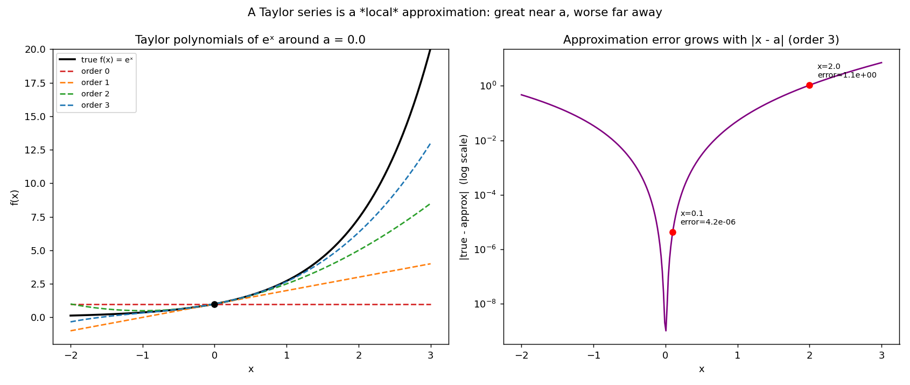

# Taylor Series Expansion 📐

A **Taylor series** is a tool I keep running into in Machine Learning: it lets me approximate a complicated function by a simple polynomial, in the neighborhood of a point.

## The intuition: approximating step by step

Say I don't know the exact value of a complicated function $f(x)$ far from a point $a$, but I know everything about $f$ *at* $a$ (its value, its slope, its curvature, ...). I can approximate the function around $a$, order by order:

- **Order 0 (constant)**: I assume the function is constant near $a$.

$$f(x) \approx f(a)$$

- **Order 1 (tangent / gradient)**: I add the slope, which gives me a tangent line.

$$f(x) \approx f(a) + f'(a)(x - a)$$

(This is exactly the linear approximation used in gradient descent!)

- **Order 2 (parabola / Hessian)**: I add the curvature, which gives me a parabola.

$$f(x) \approx f(a) + f'(a)(x - a) + \frac{f''(a)}{2!}(x - a)^2$$

(This is exactly the quadratic approximation used by Newton's Method!)

## The general formula in 1D

For a single-variable function $f(x)$, the Taylor series at point $a$ is:

$$f(x) = \sum_{n=0}^{\infty} \frac{f^{(n)}(a)}{n!} (x - a)^n = f(a) + f'(a)(x-a) + \frac{f''(a)}{2!}(x-a)^2 + \frac{f'''(a)}{3!}(x-a)^3 + \dots$$

## Worked example

I took the exponential function $f(x) = e^x$ around $a = 0$. Since the derivative of $e^x$ is always $e^x$, and $e^0 = 1$, every derivative at $a = 0$ equals $1$:

$$f(0) = 1 \qquad f'(0) = 1 \qquad f''(0) = 1 \qquad f'''(0) = 1$$

Plugging these into the formula up to order 3 (with $3! = 6$):

$$e^x \approx 1 + x + \frac{x^2}{2} + \frac{x^3}{6}$$

**A quick numerical check**: estimating $e^{0.1}$ ($x = 0.1$) with this order-3 polynomial gives $1 + 0.1 + 0.005 + 0.000167 \approx 1.105167$, extremely close to the true value $\approx 1.1051709$ — an absolute error of about $4 \times 10^{-6}$.

> 💡 **What happens if I increase the order?** Going from order 3 to order 5, the error drops from $\approx 4 \times 10^{-6}$ to something on the order of $10^{-8}$ or smaller. Every extra term is a finer correction (order 1 fixes the slope, order 2 the curvature, order 3 how the curvature itself changes, ...), and since each term is divided by a fast-growing $n!$ ($5! = 120$), higher-order terms shrink quickly while still closing the gap to the true value.

> 💡 **What if I evaluate further from $a$?** Estimating $e^{2.0}$ instead of $e^{0.1}$, at the *same* order 3, gives a **much bigger** error. A Taylor series is a *local* approximation — every term carries a factor $(x-a)^n$, and while $(0.1)^n$ shrinks fast as $n$ grows, $(2.0)^n$ *grows* fast instead ($2^2=4$, $2^3=8$, $2^4=16$...). To keep good accuracy further from $a$, I have no choice but to raise the order $N$.

## Visualization 📊

On the left, I expand $e^x$ around $a=0$ at increasing orders — each one hugs the true curve a little more, but they all drift away the further $x$ gets from $0$. On the right, I fix the order at 3 and plot the approximation error as a function of $x$: it's tiny right around $a$ and blows up as $x$ moves away, exactly matching $x=0.1$ vs. $x=2.0$ from the worked example.



*Generated by [`plot_taylor_series.py`](plot_taylor_series.py).*

## Scripts in this folder

- [`taylor_series.py`](taylor_series.py) — `taylor_expansion_1d`, computed **numerically**: the $n$-th derivative is estimated via finite differences (`numerical_derivative`) rather than known analytically, so the same code works on *any* Python function, not just ones whose derivatives I've worked out by hand.
- [`plot_taylor_series.py`](plot_taylor_series.py) — the visualization above.

## Pseudo-code: Taylor_Series_Expansion_1D

```text
ALGORITHM: Taylor_Series_Expansion_1D

INPUT:
    - f: scalar function to approximate
    - a: expansion point (e.g. a = 0)
    - x: evaluation point where I want to estimate f(x)
    - order_N: maximum order of the polynomial approximation (e.g. N = 3)

OUTPUT:
    - approx: estimated value of f(x) via the order-N Taylor polynomial

BEGIN
    1. Initialize approx = 0

    2. FOR n from 0 to order_N DO:

           a. Compute the n-th derivative of f at point a: nth_diff = f_derivative(f, a, n)

           b. Compute the factorial of n: fact = factorial(n)

           c. Compute the polynomial term: term = (nth_diff / fact) * ((x - a)^n)

           d. Add to the running total: approx = approx + term

       END FOR

    3. RETURN approx
END
```

**A note on computing the derivatives $f^{(n)}(a)$**: analytically (symbolically), I'd need the closed-form formula for successive derivatives (easy for $e^x$, where every derivative equals $e^a$ — less easy in general). Numerically, I can estimate the $n$-th derivative via finite differences (what `taylor_series.py` does) or reach for automatic differentiation (e.g. Autograd or PyTorch). The numerical route is what makes the script flexible enough to approximate the Taylor series of *any* Python function, even ones I don't know the analytical derivative of.

⬅️ Back to [Multivariable Calculus overview](../README.md) · Previous: [Lagrangian Multipliers](../05-lagrangian-multipliers/README.md)
