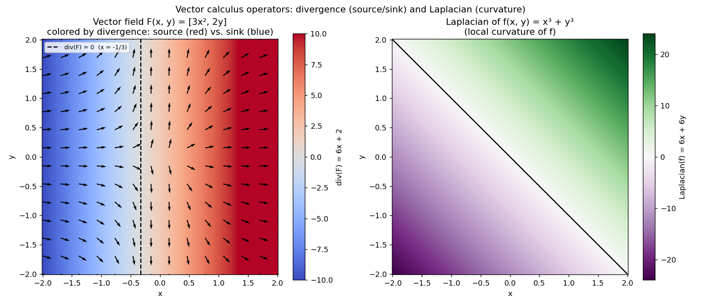

# Vector Calculus 🔄

**Vector calculus** extends derivatives and gradients to **vector fields**, which is essential for understanding advanced optimization and system dynamics in Machine Learning.

## Vector fields

So far, the functions studied here were **scalar** functions $f(x, y)$ - each point maps to a single value (like a temperature). A **vector field** $\mathbf{F}(\mathbf{r})$ instead maps each point in space to a **vector**.

A concrete example: wind velocity at every point on Earth, or the direction and magnitude of the loss gradient at every point in a parameter space.

## The fundamental operators

In vector calculus, three main operators are built from the differential operator **nabla** $\nabla$:

$$\nabla = \begin{pmatrix} \dfrac{\partial}{\partial x} \\[4pt] \dfrac{\partial}{\partial y} \\[4pt] \dfrac{\partial}{\partial z} \end{pmatrix}$$

| Operator | Symbol | Definition / physical meaning | Used for (ML / physics) |
|---|---|---|---|
| Gradient 📈 | $\nabla f$ | Direction of the steepest increase of a scalar function. | Optimization (Gradient Descent). |
| Divergence 🚰 | $\nabla \cdot \mathbf{F}$ | Measures whether a point acts as a source ($>0$) or a sink ($<0$) of flow. | Conservation of mass/probability (Fokker-Planck equations, Normalizing Flows). |
| Laplacian 🌐 | $\Delta f = \nabla^2 f$ | Sum of the pure second partial derivatives ($\text{div}(\text{grad}(f))$); measures local curvature. | Graph smoothing (Graph Neural Networks), regularization. |

## Focus on divergence

For a vector field $\mathbf{F}(x, y) = \begin{pmatrix} P(x, y) \\ Q(x, y) \end{pmatrix}$, the divergence of $\mathbf{F}$ is the symbolic dot product of $\nabla$ with $\mathbf{F}$:

$$\text{div}(\mathbf{F}) = \nabla \cdot \mathbf{F} = \frac{\partial P}{\partial x} + \frac{\partial Q}{\partial y}$$

### Worked example

I took the vector field:

$$\mathbf{F}(x, y) = \begin{pmatrix} 3x^2 \\ 2y \end{pmatrix}$$

- $\dfrac{\partial P}{\partial x} = \dfrac{\partial}{\partial x}(3x^2) = 6x$
- $\dfrac{\partial Q}{\partial y} = \dfrac{\partial}{\partial y}(2y) = 2$
- $\nabla \cdot \mathbf{F} = 6x + 2$

**Reading the result geometrically**: the divergence here depends only on $x$.

- If $x > -1/3$: divergence is positive - the point acts as a **source** ⛲ (the flow "creates" matter/expands).
- If $x < -1/3$: divergence is negative - the point acts as a **sink** 🕳️ (the flow gets absorbed/compresses).
- If $x = -1/3$: divergence is zero - the flow is locally incompressible there.

(That boundary comes from solving $6x + 2 = 0 \implies x = -\dfrac{2}{6} = -\dfrac{1}{3}$.)

## The Laplacian

The **Laplacian** (denoted $\Delta f$ or $\nabla^2 f$) applies to a scalar function $f$ and is the divergence of its gradient:

$$\Delta f = \nabla \cdot (\nabla f) = \frac{\partial^2 f}{\partial x^2} + \frac{\partial^2 f}{\partial y^2}$$

It essentially measures the local average curvature - how a point's value compares to the average of its neighbors.

### Worked example

For $f(x, y) = x^3 + y^3$, the gradient is $\nabla f = \begin{pmatrix} 3x^2 \\ 3y^2 \end{pmatrix}$. Differentiating the first component with respect to $x$ and the second with respect to $y$:

$$\frac{\partial^2 f}{\partial x^2} = \frac{\partial}{\partial x}(3x^2) = 6x \qquad \frac{\partial^2 f}{\partial y^2} = \frac{\partial}{\partial y}(3y^2) = 6y$$

$$\Delta f = 6x + 6y$$

## Visualization 📊

On the left, the vector field $\mathbf{F}(x, y) = [3x^2, 2y]$ with its background colored by divergence: red where it behaves like a source, blue where it behaves like a sink, split exactly at $x = -1/3$. On the right, the Laplacian of $f(x, y) = x^3 + y^3$ as a heatmap, with its own zero-crossing line.



*Generated by [`plot_vector_calculus.py`](plot_vector_calculus.py).*

## Scripts in this folder

- [`vector_calculus.py`](vector_calculus.py) — `compute_divergence_2d` and `compute_laplacian_2d` via centered finite differences, checked against the two hand-computed exact results above.
- [`plot_vector_calculus.py`](plot_vector_calculus.py) — the visualization above.

## Pseudo-code: Vector_Divergence_2D

```text
ALGORITHM: Vector_Divergence_2D

INPUT:
    - F_x(x, y): x-component of the vector field
    - F_y(x, y): y-component of the vector field
    - (x, y): evaluation point
    - h: step size (e.g. 1e-5)

OUTPUT:
    - div: scalar divergence value at (x, y)

BEGIN
    1. Compute the partial derivative dF_x / dx:
       dFx_dx = (F_x(x + h, y) - F_x(x - h, y)) / (2 * h)

    2. Compute the partial derivative dF_y / dy:
       dFy_dy = (F_y(x, y + h) - F_y(x, y - h)) / (2 * h)

    3. Compute the divergence:
       div = dFx_dx + dFy_dy

    RETURN div
END
```

## Pseudo-code: Scalar_Laplacian_2D

```text
ALGORITHM: Scalar_Laplacian_2D

INPUT:
    - f(x, y): scalar function
    - (x, y): evaluation point
    - h: step size (e.g. 1e-5)

OUTPUT:
    - lap: scalar Laplacian value at (x, y)

BEGIN
    1. Compute the second partial derivative d^2f / dx^2:
       d2f_dx2 = (f(x + h, y) - 2 * f(x, y) + f(x - h, y)) / (h^2)

    2. Compute the second partial derivative d^2f / dy^2:
       d2f_dy2 = (f(x, y + h) - 2 * f(x, y) + f(x, y - h)) / (h^2)

    3. Compute the Laplacian:
       lap = d2f_dx2 + d2f_dy2

    RETURN lap
END
```

⬅️ Back to [Multivariable Calculus overview](../README.md) · Previous: [Taylor Series Expansion](../06-taylor-series-expansion/README.md)
